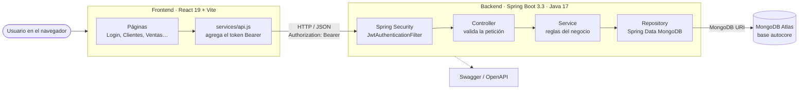
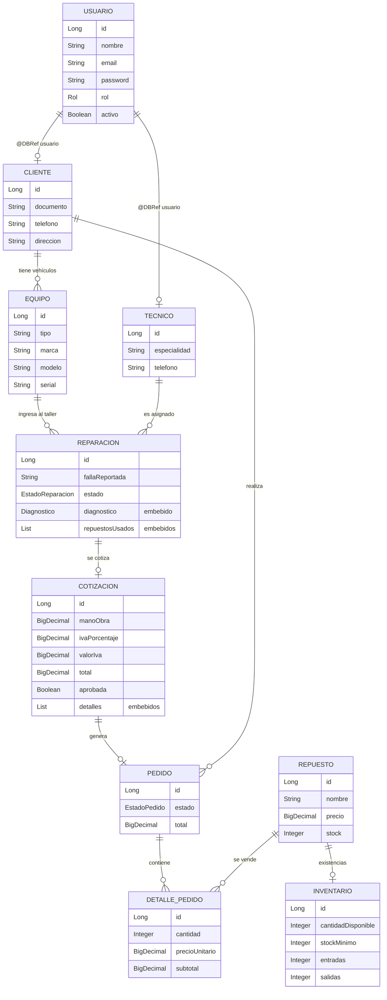
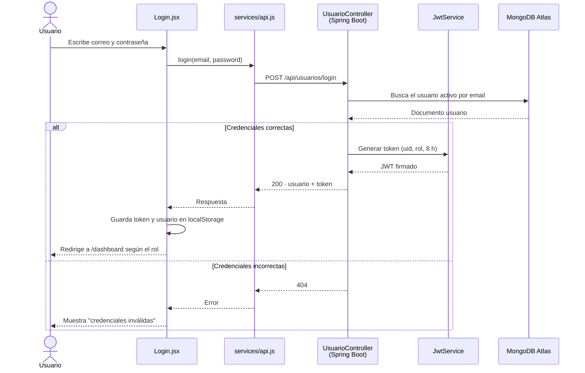
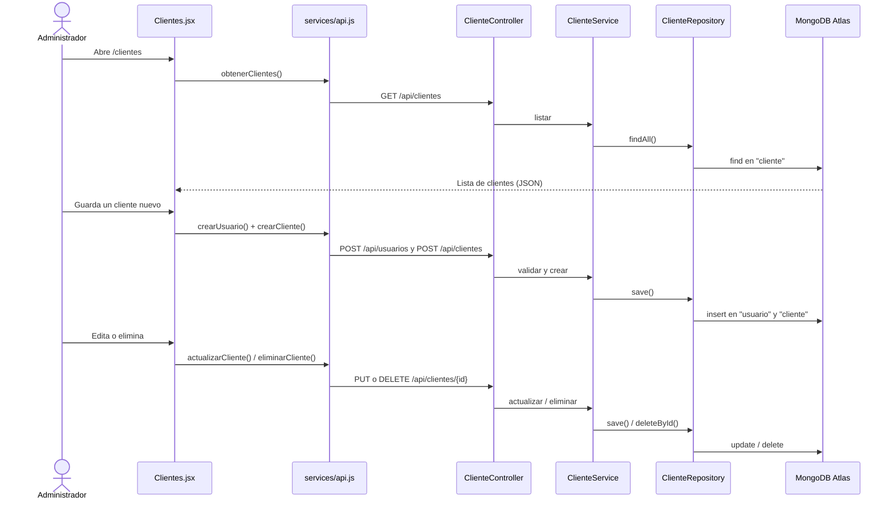
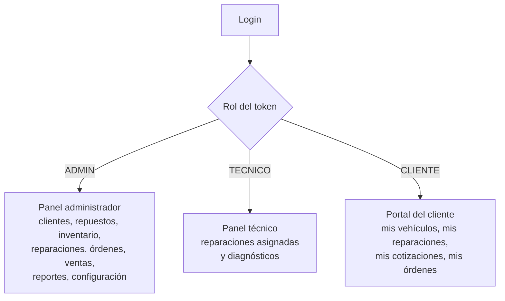
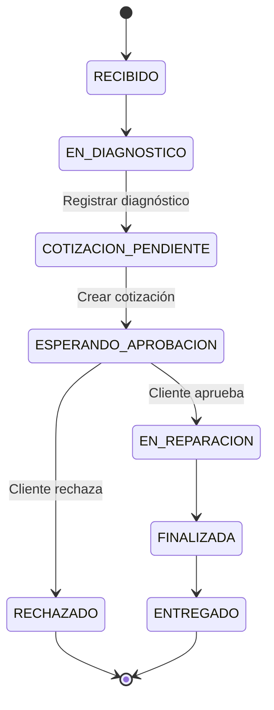
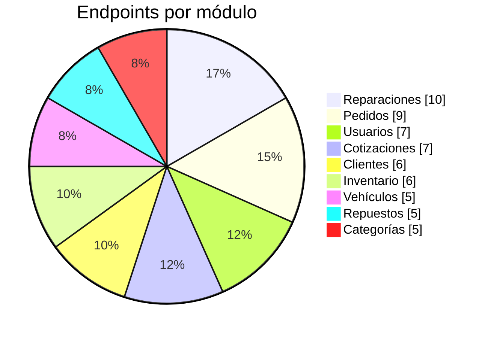
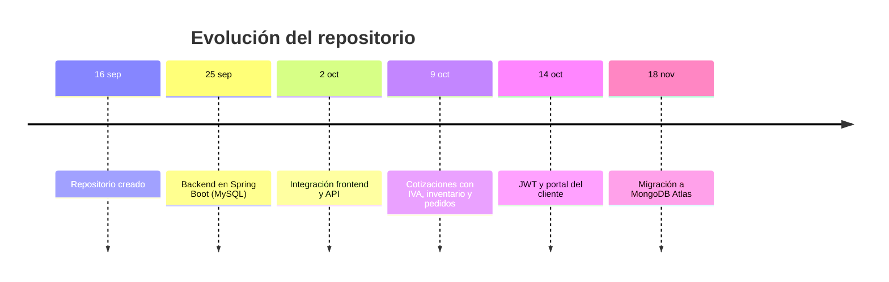

# 🚗 AutoCore


**Proyecto académico:** Entornos de Programación (24542)
**Institución:** Universidad Industrial de Santander (UIS)
**Grupo:** F1 · **Año:** 2026
**Entrega:** Sprint 1 - 2 · Spring Boot - NoSQL - React

AutoCore es una aplicación web **FullStack** para gestionar un taller de reparación automotriz. Centraliza clientes, vehículos, repuestos, inventario, reparaciones, cotizaciones, pedidos y ventas, con vistas para los roles de administrador, técnico y cliente.

- **Base de datos:** MongoDB Atlas, una base no relacional en la nube.
- **Backend:** Spring Boot 3, con una API REST, login y JWT.
- **Frontend:** React 19 con Vite, que consume esa API.

## Contenido

- [Cumplimiento de los requisitos](#cumplimiento-de-los-requisitos)
- [Funcionalidades](#funcionalidades)
- [Tecnologías](#tecnologías)
- [Arquitectura](#arquitectura)
- [Base de datos NoSQL en MongoDB Atlas](#base-de-datos-nosql-en-mongodb-atlas)
- [Login del usuario](#login-del-usuario)
- [CRUD de documentos](#crud-de-documentos)
- [Módulos y roles](#módulos-y-roles)
- [Flujo de reparación y cotización](#flujo-de-reparación-y-cotización)
- [Cotizaciones, IVA y factura imprimible](#cotizaciones-iva-y-factura-imprimible)
- [Estructura del proyecto](#estructura-del-proyecto)
- [Requisitos para ejecutar](#requisitos-para-ejecutar)
- [Configuración y ejecución local](#configuración-y-ejecución-local)
- [API y documentación](#api-y-documentación)
- [Configuración sensible](#configuración-sensible)
- [Estado del proyecto](#estado-del-proyecto)
- [Equipo](#equipo)

## Cumplimiento de los requisitos

| Requisito de la entrega | Cómo lo cumple AutoCore | Dónde está |
|---|---|---|
| Solución FullStack en grupo | Frontend React + backend Spring Boot + base de datos en la nube, desarrollados por el grupo F1 | Todo el repositorio |
| Base de datos no relacional hospedada en la nube | **MongoDB Atlas** (base `autocore`) con 11 colecciones de documentos | `backend-spring/src/main/resources/application.properties` |
| Backend con Spring Boot que gestione la base de datos | API REST con Spring Boot 3.3.4, Java 17 y Spring Data MongoDB, organizada en Controller → Service → Repository | `backend-spring/` |
| CRUD de alguno de los documentos | CRUD completo (crear, listar, consultar, actualizar y eliminar) de **usuarios, clientes, vehículos, repuestos, categorías e inventario** | `/api/usuarios`, `/api/clientes`, `/api/equipos`, … |
| Acceso al login del usuario | `POST /api/usuarios/login` valida las credenciales y devuelve un **token JWT** con el rol | `usuario/UsuarioController.java`, `security/` |
| Frontend React: login del usuario | Pantalla de login que guarda el token y redirige al panel según el rol | `frontend/src/pages/Login.jsx` |
| Frontend React: CRUD de un documento | Módulo **Clientes** con alta, listado, edición y eliminación contra la API | `frontend/src/pages/Clientes.jsx`, `frontend/src/services/api.js` |
| Documento anexo con gráficas | Este README, con diagramas de arquitectura, login, CRUD, modelo de datos y estados | `README.md` |

## Funcionalidades

- Inicio de sesión con JWT y vistas diferenciadas por rol (`ADMIN`, `TECNICO` y `CLIENTE`).
- Gestión de clientes y vehículos asociados.
- Catálogo de repuestos con precios, categorías y estado.
- Control de inventario: cantidades disponibles, entradas, salidas y stock mínimo.
- Gestión de reparaciones, asignación de técnicos y registro de diagnósticos.
- Registro de repuestos utilizados durante una reparación, con descuento automático del stock.
- Creación y gestión de cotizaciones vinculadas a reparaciones.
- Aprobación y rechazo de cotizaciones.
- Pedidos asociados a cotizaciones y consulta de órdenes del taller.
- Portal del cliente: mis vehículos, mis reparaciones, mis cotizaciones y mis órdenes.
- Vista previa e impresión de documentos de cotización/factura de servicio.
- Cálculo de subtotal, IVA y total cuando el desglose de IVA está habilitado y guardado en la cotización.
- Reportes e indicadores generales del taller.

> **Nota:** la factura imprimible del frontend es un documento de gestión. No constituye por sí sola una factura electrónica validada por la DIAN. El porcentaje de IVA debe configurarse de acuerdo con el tratamiento tributario que corresponda.

## Tecnologías

| Componente | Tecnología |
|---|---|
| Frontend | React 19, Vite 8, React Router |
| Backend | Java 17, Spring Boot 3.3.4 |
| API | REST (JSON) |
| Seguridad | Spring Security + JWT (jjwt 0.12.6) |
| Persistencia | Spring Data MongoDB |
| Base de datos | MongoDB Atlas (NoSQL en la nube) |
| Documentación de API | Swagger / OpenAPI (springdoc) |
| Control de versiones | Git y GitHub |

## Arquitectura



El frontend consume la API REST del backend. Cada petición pasa por el filtro de seguridad, que comprueba el token JWT. Después, el controlador valida los datos, el servicio aplica las reglas del taller y el repositorio lee o escribe en MongoDB Atlas.

Todos los módulos del backend siguen la misma estructura: `Entidad`, `Controller`, `Service`, `Repository` y DTOs de entrada y salida (`Request` / `Response`).

## Base de datos NoSQL en MongoDB Atlas

La información se guarda como **documentos** en colecciones de MongoDB Atlas. No hace falta instalar MongoDB en el computador; basta con la URI del clúster.

### Colecciones y relaciones



También existe la colección `categoria` para clasificar repuestos y la colección técnica `mongo_sequences`, que lleva los contadores de IDs.

### Decisiones del modelo

- **Datos embebidos:** lo que solo pertenece a un documento se guarda dentro de él. Así ocurre con los detalles de una cotización y con el diagnóstico y los repuestos usados de una reparación. Se leen en una sola consulta.
- **Referencias `@DBRef`:** las entidades que viven por su cuenta, como el cliente, el equipo, el técnico o el repuesto, se enlazan por referencia y sus datos no se copian.
- **IDs numéricos:** `MongoIdGenerator` asigna IDs 1, 2, 3… con la colección `mongo_sequences`. Así las rutas de la API (`/api/clientes/1`) siguen igual que antes de la migración.

### Ejemplo de documento: una cotización

```json
{
  "_id": 1,
  "reparacion": { "$ref": "reparacion", "$id": 1 },
  "manoObra": 150000,
  "ivaPorcentaje": 19,
  "valorIva": 51300,
  "total": 321300,
  "aprobada": null,
  "detalles": [
    {
      "repuesto": { "$ref": "repuesto", "$id": 3 },
      "cantidad": 1,
      "precioUnitario": 120000,
      "subtotal": 120000
    }
  ]
}
```

### De MySQL a MongoDB Atlas

| Aspecto | Antes | Ahora |
|---|---|---|
| Dónde corre | MySQL local en cada computador | Clúster compartido en MongoDB Atlas |
| Acceso a datos | JPA / Hibernate | Spring Data MongoDB |
| Estructura | Tablas y llaves foráneas | Colecciones de documentos |
| Detalles de cotización | Tabla aparte | Embebidos en la cotización |
| IDs | `AUTO_INCREMENT` | `mongo_sequences` |
| Configuración | Usuario, contraseña y URL JDBC | Una sola URI (`MONGODB_URI`) |

`src/main/resources/schema.sql` es un archivo heredado de MySQL y ya no participa en el arranque.

## Login del usuario



Después del login, `services/api.js` envía `Authorization: Bearer <token>` en cada petición. En el backend, `JwtAuthenticationFilter` valida el token antes de que la petición llegue al controlador. Si el token falta o venció, la API responde 401 y el frontend cierra la sesión.

Solo son públicos `/api/usuarios/login`, `/api/usuarios/loginclient` y Swagger. El token dura 8 horas y lleva los claims `uid` y `rol`.

## CRUD de documentos

El módulo **Clientes** muestra el CRUD completo desde React hasta MongoDB Atlas:



| Operación | Método y ruta | Función en `api.js` |
|---|---|---|
| Crear | `POST /api/clientes` | `crearCliente(cliente)` |
| Listar | `GET /api/clientes` | `obtenerClientes()` |
| Consultar uno | `GET /api/clientes/{id}` | `obtenerCliente(id)` |
| Consultar por usuario | `GET /api/clientes/usuario/{usuarioId}` | `obtenerClientePorUsuario(usuarioId)` |
| Actualizar | `PUT /api/clientes/{id}` | `actualizarCliente(id, cliente)` |
| Eliminar | `DELETE /api/clientes/{id}` | `eliminarCliente(id)` |

El mismo patrón CRUD está disponible para `usuarios`, `equipos`, `repuestos`, `categorias` e `inventarios`.

Ejemplo de cuerpo para crear un cliente:

```json
{
  "usuarioId": 3,
  "documento": "1098765432",
  "telefono": "3001234567",
  "direccion": "Cra 27 # 9-00, Bucaramanga"
}
```

## Módulos y roles

| Módulo | Descripción |
|---|---|
| Login | Inicio de sesión y lectura del rol del usuario |
| Dashboard | Panel de acuerdo con el rol |
| Clientes | Datos de los clientes (CRUD) |
| Vehículos | Vehículos asociados a los clientes |
| Repuestos | Catálogo, precios y disponibilidad |
| Inventario | Existencias, movimientos y stock mínimo |
| Reparaciones | Diagnóstico, técnico asignado, estados y repuestos usados |
| Órdenes | Consulta y seguimiento de órdenes de servicio |
| Ventas | Cotizaciones, aprobación/rechazo, pedidos y documentos imprimibles |
| Reportes | Indicadores operativos y comerciales |
| Configuración | Opciones de configuración disponibles en la interfaz |



### Administrador

Gestiona los módulos generales del taller: clientes, repuestos, inventario, reparaciones, órdenes, ventas, reportes y configuración.

### Técnico

Consulta las reparaciones asignadas y la información necesaria para diagnosticar y realizar los trabajos.

### Cliente

Consulta sus vehículos, el estado de sus reparaciones, aprueba o rechaza cotizaciones y revisa sus órdenes.

## Flujo de reparación y cotización



El backend controla las transiciones de estado: solo permite pasar al siguiente estado válido. Registrar el diagnóstico habilita la creación de la cotización, y la aprobación permite continuar con la reparación.

### Edición y nueva aprobación

Cuando una cotización se modifica, el subtotal, el IVA y el total deben recalcularse y la cotización debe volver a quedar pendiente de aprobación. La edición no debe alterar silenciosamente un pedido ya creado: si existe un pedido asociado, la operación debe bloquearse o gestionarse mediante un flujo explícito de revisión del pedido.

## Cotizaciones, IVA y factura imprimible

La cotización se relaciona con una reparación e incluye mano de obra y repuestos. Cuando el desglose tributario está habilitado, se almacenan:

- `manoObra`: valor de la mano de obra.
- `ivaPorcentaje`: porcentaje de IVA aplicado.
- `valorIva`: valor calculado del impuesto.
- `total`: importe total de la cotización.

El cálculo lo hace el servidor con el precio actual de cada repuesto:

```text
Subtotal = mano de obra + suma de repuestos
IVA      = subtotal × ivaPorcentaje / 100
Total    = subtotal + valorIva
```

Ejemplo: mano de obra 150.000 + pastillas 120.000 = subtotal 270.000. Con IVA del 19 % (51.300), el total es **321.300**.

La vista de factura puede mostrar el cliente, vehículo, técnico, reparación, detalle del servicio, subtotal, IVA y total. Además, permite imprimir el documento o guardarlo como PDF desde el navegador.

## Estructura del proyecto

```text
AutoCore/
├── backend-spring/
│   ├── src/main/java/com/proyecto/clases/
│   │   ├── categoria/      cliente/      cotizacion/
│   │   ├── equipo/         inventario/   pedido/
│   │   ├── reparacion/     repuesto/     usuario/
│   │   ├── config/         (MongoIdGenerator, DatosIniciales, OpenApiConfig)
│   │   ├── security/       (SecurityConfig, JwtService, JwtAuthenticationFilter)
│   │   ├── exception/      (GlobalExceptionHandler)
│   │   └── ClasesApplication.java
│   ├── src/main/resources/
│   │   ├── application.properties
│   │   └── application-local.properties.example
│   ├── mvnw
│   ├── mvnw.cmd
│   ├── pom.xml
│   └── README.md
├── frontend/
│   ├── public/
│   │   └── logo.png
│   ├── src/
│   │   ├── pages/          (Login, Clientes, Inventario, Ventas, Mis…)
│   │   ├── services/api.js
│   │   ├── App.jsx
│   │   └── index.css
│   ├── package.json
│   └── vite.config.js
├── .gitignore
└── README.md
```

## Requisitos para ejecutar

- Java 17.
- Node.js y npm compatibles con la versión de Vite del proyecto.
- Una cuenta de MongoDB Atlas y un clúster gratuito (no hace falta descargar MongoDB).
- Git (opcional para ejecutar; necesario para contribuir al repositorio).

## Configuración y ejecución local

### 1. Base de datos MongoDB Atlas

1. Crea o reanuda un clúster gratuito en Atlas.
2. En **Network Access**, autoriza la IP desde la que usarás la aplicación.
3. En **Database Access**, crea un usuario de base de datos.
4. Copia `backend-spring/src/main/resources/application-local.properties.example` como `application-local.properties` en esa misma carpeta.
5. Reemplaza la URI de ejemplo por la URI Java de Atlas y define una clave JWT local de al menos 32 caracteres.

No subas ese archivo ni compartas contraseñas. También puedes usar las variables de entorno `MONGODB_URI` y `JWT_SECRET`.

### 2. Backend

Abre una terminal en la carpeta raíz y ejecuta:

```powershell
cd backend-spring
.\mvnw.cmd spring-boot:run
```

- Backend: `http://localhost:8080`
- Swagger/OpenAPI: `http://localhost:8080/swagger-ui.html`

Si la colección de usuarios está vacía, el backend crea datos de demostración al arrancar:

| Rol | Correo | Contraseña |
|---|---|---|
| Administrador | `admin@taller.com` | `admin123` |
| Técnico | `carlos@taller.com` | `tec123` |
| Cliente | `juan@mail.com` | `cli123` |

### 3. Frontend

Abre una segunda terminal en la raíz del proyecto:

```powershell
cd frontend
npm install
npm run dev
```

Vite normalmente publica la aplicación en `http://localhost:5173`. El frontend llama a la API en `http://localhost:8080/api`.

## API y documentación

La API tiene **60 endpoints** en **9 módulos**:

| Módulo | Endpoint base | Endpoints |
|---|---|---|
| Usuarios y login | `/api/usuarios` | 7 |
| Clientes | `/api/clientes` | 6 |
| Vehículos | `/api/equipos` | 5 |
| Repuestos | `/api/repuestos` | 5 |
| Categorías | `/api/categorias` | 5 |
| Inventario | `/api/inventarios` | 6 |
| Reparaciones y diagnósticos | `/api/reparaciones` | 10 |
| Cotizaciones | `/api/cotizaciones` | 7 |
| Pedidos | `/api/pedidos` | 9 |



Además del CRUD, hay operaciones específicas:

- `PATCH /api/reparaciones/{id}/tecnico/{tecnicoId}`: asignar técnico.
- `PUT /api/reparaciones/{id}/diagnostico`: registrar el diagnóstico.
- `PATCH /api/reparaciones/{id}/estado`: cambiar el estado.
- `POST /api/reparaciones/{id}/repuestos`: registrar un repuesto usado (descuenta stock).
- `PATCH /api/cotizaciones/{id}/aprobar` y `/rechazar`: responder la cotización.
- `GET /api/pedidos/cotizacion/{cotizacionId}` y `/api/pedidos/{pedidoId}/detalles`: consultar pedidos.

Los errores se devuelven con un manejador global: **400** para datos inválidos o stock insuficiente, **404** si el recurso no existe y **409** para conflictos (por ejemplo, un documento repetido).

Todos los endpoints, con sus parámetros y ejemplos, se pueden probar en Swagger. Para más detalle sobre los controladores y el flujo del backend, consulta [backend-spring/README.md](backend-spring/README.md).

## Configuración sensible

- No subas contraseñas, tokens ni archivos de configuración local.
- Usa `application-local.properties` para la URI de MongoDB Atlas y la clave JWT local; el archivo está fuera de Git.
- Antes de publicar el repositorio, revisa que no haya claves reales en archivos de configuración ni datos personales que no deban compartirse.
- Los datos iniciales son para desarrollo y pruebas; cámbialos y aplica medidas de seguridad antes de cualquier despliegue real.

## Estado del proyecto

AutoCore integra frontend React, backend Spring Boot y persistencia en MongoDB Atlas. El alcance incluye gestión de clientes, vehículos, repuestos, inventario, reparaciones, cotizaciones, pedidos, ventas y reportes.



Próximos pasos:

- **Permisos por rol:** el token ya incluye el rol, pero falta que cada endpoint lo verifique.
- **Contraseñas cifradas** con BCrypt; hoy los usuarios de demostración se guardan en texto plano.
- **Pruebas automatizadas** de servicios y endpoints con Spring Boot Test.

## Equipo

| Integrante | Responsabilidades |
|---|---|
| **Jairo Armando Cardozo Mendoza** | Frontend, inventario, interfaz de usuario y Jira |
| **Jose Fernando Estevez Cardenas** | Backend con Spring Boot |
| **Alejandro Salazar Rincón** | Base de datos, órdenes, ventas y Node.js |

Proyecto académico de **Entornos de Programación (24542)** · Universidad Industrial de Santander (UIS) · Grupo F1 · 2026.
